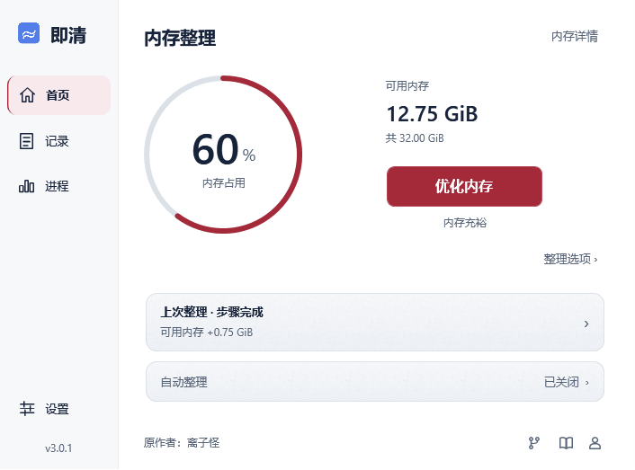
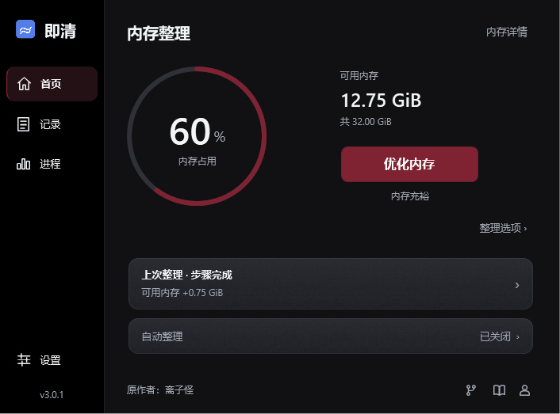

<p align="center"></p>

<h1 align="center">Click-Clean 即清</h1>

<p align="center">手动一键执行全系统三步，自动整理保持保守；真实结果，不承诺提速。</p>

<p align="center"><a href="https://github.com/ice11123/Click-Clean/releases/latest">下载最新版</a> · <a href="docs/user-guide.md">使用说明</a> · <a href="https://github.com/ice11123/Click-Clean/issues">反馈问题</a> · <a href="LICENSE">GPL-3.0</a></p>

**推荐：Windows 11 x64 正式版。** 自带 .NET 运行时，安装后即可使用。原作者：**离子怪（ice11123）**。

## 下载 3.0.3

| 你需要什么 | 下载 | 说明 |
| --- | --- | --- |
| 正常安装使用 | [Windows x64 安装包](https://github.com/ice11123/Click-Clean/releases/download/v3.0.3/Click-Clean-3.0.3-win-x64-Setup.exe) | 推荐；普通权限界面，包含受保护系统组件 |
| 解压即用 | [Windows x64 便携包](https://github.com/ice11123/Click-Clean/releases/download/v3.0.3/Click-Clean-3.0.3-win-x64-Portable.zip) | 运行 current/ClickClean.exe；手动三步需要已安装系统组件 |
| 测试32位进程 | [x86 试验便携包](https://github.com/ice11123/Click-Clean/releases/download/v3.0.3/Click-Clean-3.0.3-win-x86-Experimental.zip) | 仅用于64位 Windows 11；不支持全系统三步、登录启动及应用内更新 |
| 阅读或构建源码 | [源码包](https://github.com/ice11123/Click-Clean/releases/download/v3.0.3/Click-Clean-3.0.3-Source.zip) | 包含构建脚本、许可和文档 |

[发行说明与所有附件](https://github.com/ice11123/Click-Clean/releases/latest) · [SHA-256 校验文件](https://github.com/ice11123/Click-Clean/releases/download/v3.0.3/SHA256SUMS.txt)

已安装正式版可在应用内检查更新，点击下载后再点击“重启并更新”。普通界面更新无需再次运行安装向导，应用不会自动下载或重启。**从2.x升级3.0建议运行安装包，完成受保护组件和旧登录任务的迁移**；应用内更新不会从用户可写缓存提权安装组件。当前包未签名。

## 界面

3.0.3恢复手动原版三步。**尚未部署受保护系统组件的用户，本次必须运行完整安装包**；仅应用内更新不能补装该组件。x86试验版不支持手动全系统三步。

<table><tr><td></td><td></td></tr></table>

截图使用模拟读数。圆角卡片采用应用内磨砂质感。

## 日常使用

- **手动即执行**：首页、托盘、整理岛直接执行全系统三步，不因低占用或场景判断跳过；需要UAC授权。
- **自动由你选择**：百分比模式按设定门槛执行三步；系统通知模式只整理闲置后台。自动默认关闭，保留冷却和可选场景避让。
- **看得清楚**：首页只显示短状态、主操作和结果；完整返回码与观测结果按需展开。
- **桌面整理岛**：靠近任务栏中央浮出，点击整理；显示过程与两秒成果，然后恢复实时读数。
- **按你决定运行**：阈值、定时整理默认关闭；新安装默认浅色并开启岛，旧偏好保留。
- **有据可查**：保留最近30次记录，支持进程内存增长观察与日志导出。
- **语言可选**：简体中文与English即时切换，首次选择后随升级保留。

手动全系统三步可能增加缺页、重新加载及磁盘活动；自动后台回收也可能产生恢复代价。可用内存或工作集下降不等于提速，也不能修复其他程序的内存泄漏。默认55%是可配置的自动占用门槛，百分比模式不再叠加系统通知；手动不受门槛限制。详见[整理原理与使用说明](docs/user-guide.md#整理与自动化)。

## 平台与验证范围

| 平台 | 当前状态 |
| --- | --- |
| Windows 11 x64 | 正式安装包、便携包及应用内更新 |
| x86 / 32位进程 | 试验便携包，在 Windows 11 x64 的 WOW64 下运行；无登录启动和应用内更新 |
| Linux / macOS | 当前未支持；需要移植界面与系统整理实现 |
| 32位 Windows 系统 | 未支持；Windows 11 本身无32位系统版本 |

构建通过不代表已在所有环境验证，也不代表任何游戏都能提高帧率。x86的界面与只读探针可在本机检查；高级组件只支持x64。参见[本次测试与限制](docs/verification-3.0.3.md)及[平台说明](docs/platforms.md)。

## 文档与源码

[使用说明](docs/user-guide.md) · [更新记录](CHANGELOG.md) · [架构](docs/architecture.md) · [安全说明](SECURITY.md) · [贡献指南](CONTRIBUTING.md)

```powershell
.\build.ps1 -OutputRoot .\dist
.\build-x86-experimental.ps1 -OutputRoot .\dist-x86
```

需要 .NET SDK 10、Windows构建环境与生成安装包所需的 Inno Setup 7。高级组件使用Native AOT，还需要微软C++工具链，或同一组件源码的CI产物通过 `-PrivilegedPublishDir` 输入。[完整构建说明](docs/user-guide.md#从源码构建)。

Copyright © 2026 离子怪及贡献者。源码按 [GPL-3.0-only](LICENSE) 允许合规使用、修改和分发；品牌见 [BRANDING.md](BRANDING.md)。

[离子怪博客](https://ice11123.github.io/blog_test2/) · [作者 GitHub](https://github.com/ice11123)
