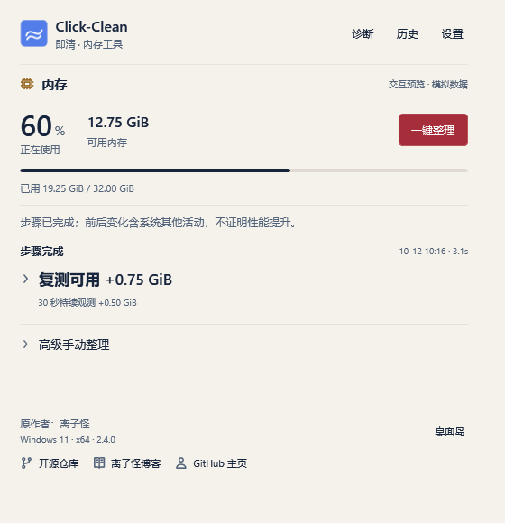
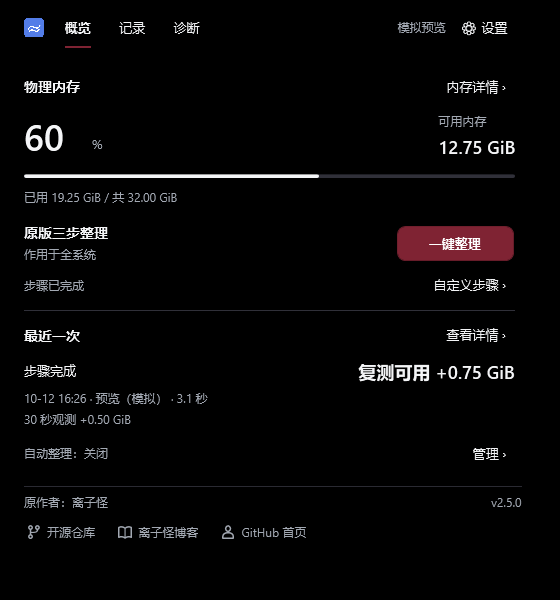
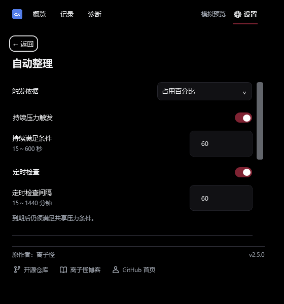

# Click-Clean 即清

Windows 11 x64 的中文内存整理工具，使用 C#、.NET 10 和原生 WPF。

原作者：**离子怪（ice11123）**。主窗口作者区提供三个使用不同矢量图标的入口：[GitHub 开源仓库](https://github.com/ice11123/Click-Clean)、[离子怪博客（blog2）](https://ice11123.github.io/blog_test2/)、[离子怪 GitHub 首页](https://github.com/ice11123)。链接仅在用户点击时由默认浏览器打开，不内嵌网页或下载外部视觉资源。

2.5.0 全面重构桌面界面：默认窗口 560×600，采用“概览 / 记录 / 诊断”固定导航与独立设置分类。概览集中显示内存、一键整理及最近结果，自定义步骤和技术详情按需打开。设置使用常规与外观、自动整理、版本更新、关于与数据四组；自动参数关闭时收起，编辑先保存草稿。浅色采用浅灰/白、深蓝文字、红色主操作与少量金色；深色采用黑、暗红、白。原图标、作者和三个不同图标外链保留。详见[重构说明](docs/ui-reconstruction-2.5.md)。

底部整理岛仍固定在主屏任务栏上方中央，鼠标靠近浮出、离开收回，点击执行原版三步整理，没有附加按钮或菜单。内存增长排行是独立诊断页，仅按需读取。支持自定义手动整理及默认关闭的阈值/定时整理。

新安装默认开启底部整理岛，默认浅色主题，主窗口与岛保持一致。设置中可切换深色或跟随系统；已有用户主动关闭岛或选择的主题不会被覆盖。






截图使用明确标注的模拟数据，不是本机清理效果承诺。

底部岛显示实际步骤或复测状态、结果（2 秒）、实时内存占用率。浮出时每秒更新，收起时降为 10 秒采样。背景与文字跟随应用主题，浮出时短暂显示局部渐变，整理时小范围移动；灯色按浅深色分别校核可见度，浅色不再使用醒目金边；收起、禁用、减少动画、高对比时停止背景时钟。呼吸灯按占用率分档：低于 60% 绿色、60%～85% 琥珀色、85% 及以上珊瑚红；未知读数为灰色。颜色不是硬件故障警告，不增加岛内选项。

呼吸灯分档采用 2 个百分点的迟滞以减少边界闪动，数字仍显示实际占用。主窗口隐藏但岛浮出时，岛继续显示呼吸与状态；岛收起或隐藏时停钟。换色使用180毫秒过渡，减少动画时直接换色。慢速呼吸和整理背景循环限制为30帧。鼠标远离底部区域时位置检测降至500毫秒，靠近后恢复150毫秒；收起时无背景与呼吸动画。系统读数失败显示“—”，恢复后重新显示，旧数字不冒充实时数据。

主结果及岛内两秒成果优先显示约3秒的复测变化；即时读数保留在详情。约30秒的持续观测在后台补充同一条历史，不锁住整理按钮，也不再次调用整理或申请特权。新整理、清空记录、重启更新或退出会停止旧观测，避免把后续整理结果归因给前一次。持续观测包含其他系统活动，不是性能评分。

## 下载与启动

从本仓库 [Releases](https://github.com/ice11123/Click-Clean/releases) 下载正式包，核对同版本 SHA-256。安装包默认申请管理员权限，桌面快捷方式默认不勾选。便携包解压后保留完整目录，运行 `current/ClickClean.exe`。

程序默认管理员启动，UAC 开启时可能要求确认。关闭主窗口默认进入托盘；最小化保留任务栏。托盘可以打开、整理、显示桌面岛或退出。登录启动默认关闭，开启后为当前账户创建最高权限计划任务，登录后进入托盘。

脚本或快捷方式也可使用 `current/ClickClean.exe --exit` 请求正常退出；会等待当前整理步骤返回，不强行结束系统调用。此命令同样受管理员清单与 UAC 保护。

## 整理与自动化

首页、托盘和底部岛统一恢复原版三步：裁剪全系统工作集 → 刷新修改页 → 清理待机缓存。手动点击不受占用阈值限制，不再因为低占用跳过；未知或无效读数仍安全停止。自动模式才检查占用门槛，新配置默认为 55%。55% 是用户指定的产品参数，不是 Windows 官方健康界限，也不代表所有高于门槛的内存都能安全回收。

高级设置保留手动逐项选择，新用户默认选择原版三项，已有选择原样保留；空选择仍不回填三步。高级选择只影响“整理所选项目”，不改变快捷入口的原版三步。高级全系统裁剪或刷盘仍需明确确认。每步检查返回码，失败后停止后续操作；取消不打断当前系统调用。

结果保留即时可用变化、即时提交变化、系统返回码与约 3 秒后的复测相对原始值及实际间隔，不择大值、不隐去零或负值。3 秒是产品观测窗口，不是持续收益证明。观测异常与调用失败分开；取消复测不撤销已执行步骤。复测前恢复权限，复测期间保持并发保护。整理可能造成缺页或磁盘忙碌，缓存会重新建立；可用内存增加不等于提速，也不能修复其他程序的内存泄漏。

原理、硬件风险和优化方向见 [Astra 独立评估](docs/memory-review-astra.md) 及 [2.3.0 有效性复核（历史方案）](docs/memory-effectiveness-astra-2.3.md)。待机内存本来已计入可用内存，仅清待机一般不能直接降低物理占用率。公开系统缓存指标包含待机列表及系统工作集，不能当作纯待机或可释放收益。恢复三步也不等于性能优化：更强的裁剪可能导致重新加载和刷盘，而不是修复泄漏。

“设置 → 自动清理”提供两个独立开关，保存后生效：

| 参数 | 默认 |
| --- | --- |
| 阈值清理 | 关闭；55% 持续 60 秒 |
| 定时清理 | 关闭；每 60 分钟 |
| 冷却 | 30 分钟 |
| 自动步骤 | 达到配置门槛后按原版三步执行 |
| 全屏避让 | 开启；只影响自动整理 |
| 磁盘繁忙避让 | 开启；只影响自动整理 |
| 触发依据 | 占用百分比；可改为 Windows 系统低内存通知 |

定时触发也检查压力，低于配置阈值则跳过并推进周期，不计失败或实际整理时间。阈值需下降 5 个百分点才重新武装（默认需回落到50%），手动整理也进入冷却；相撞合并、忙碌不积压、休眠恢复不补跑。连续自动调用失败 3 次暂停，保存设置可恢复。自动开关默认关闭，保存已启用的自动规则需确认裁剪与刷盘代价。

全屏应用覆盖任意显示器、全盘汇总磁盘活动达到80%，或所选探针暂不可读时，会暂缓自动整理并在首页说明原因；已到期的避让周期只保留一次，条件解除后重新评估。磁盘状态需要至少两个样本，首次读取可能短暂显示不可用。系统压力模式以 Windows 通知替代百分比门槛，持续时间和冷却仍生效，定时也要求系统报告低内存；该模式解除低内存通知后重新武装。手动整理不受场景避让限制。80%磁盘活动只是避让启发式，不代表每块磁盘都处于该占用。

升级保留已有阈值、两个自动开关与高级选择，不将保存过的85%无声改成55%。旧版已开启的自动规则因步骤变更先暂停，在设置中核对参数、按需改成55%并“确认三步规则并保存”后恢复；关闭两个开关再保存则继续停用。确认状态跨重启保留。软件完全退出后不会自动清理。

## 更新与数据

默认自动检查在首页加载时一次，此后约每 6 小时；可在设置关闭检查。发现新版首页显示醒目提示。只有点击“下载更新”才下载校验；完成后还需点击“重启并更新”才短暂退出替换，无需安装向导。不会自动下载、自动替换或自动重启，整理和复测中禁止应用更新。旧自动下载/收起自动应用字段迁移为关闭，不能重新开启。

首次从清栖迁移，或安装机制改变时，可能仍需安装包。未发布新版本时报告当前版本；网络或仓库不可用时保留现有程序并显示错误。

检查更新有30秒应用层超时，检查和下载均可取消，下载显示百分比；下载15分钟超时、断网、磁盘不足或校验错误可重试。应用前校验失败会恢复重新下载入口，继续使用旧版。重启更新前保存 `before-update` 中的设置和历史快照；正式实例未完成初始化与一次Dispatcher空闲时，下次启动提供发行历史恢复入口。恢复由用户选择旧安装包完成，不保证捕获所有后续崩溃，也不自动替换为旧版。

设置、最近 30 次记录和轮转日志在 `%LOCALAPPDATA%/ClickCleanData`，与程序目录分开。首次运行复制旧清栖的有效设置与历史，保留旧数据；新增自动功能默认关闭。卸载默认保留用户数据，可以选择删除。分享导出的诊断前请检查个人信息。

当前包未进行 Authenticode 签名，也无安全厂商认证。正常使用不需要关闭杀毒、绕过 UAC 或运行下载执行脚本。

“诊断”只在页面打开且主窗口可见时每5秒采样，按本次观察的私有内存增长排序，显示进程名、当前私有内存和变化。首次样本和新进程标记“新 / 基线”，PID重用不会与旧进程混算，权限不足及退出进程计为不可读。关闭页面后停止扫描；进程列表不上传，也不写入自动诊断日志。增长不是内存泄漏结论，软件不结束进程。

安装或卸载前请从托盘正常退出；安装程序不会强行结束整理中的进程。若使用其他管理员账户输入凭据提权，当前用户目录和设置归属可能改变，建议在安装账户本身具备管理员权限时使用。

## 从源码构建

签名构建流程与证书要求见 [签名说明](docs/signing.md)。未提供有效证书时正常输出未签名包，不创建自签证书冒充发布者认证。

需要 Windows 11 x64、.NET SDK 10.0.301 或允许的补丁版本，以及完整安装包所需的官方 Inno Setup 7。

```powershell
.\build-assets.ps1
dotnet run --project Tests/ClickClean.Tests.csproj -c Release
.\build.ps1 -OutputRoot .\dist -IncludePreview
```

没有 Inno Setup 可加 `-SkipInstaller`，生成可更新便携包和源码包。CLI 通过 `.config/dotnet-tools.json` 固定版本还原；图标源图片内置于 `App/Assets/ClickClean.png`，`build-assets.ps1` 离线导出多尺寸 ICO，无需下载图片。

```powershell
dotnet run --project Diagnostics/ClickClean.Preview.csproj -c Release
```

交互预览用模拟内存和整理，不提权、不创建登录任务、不下载更新；截图检查还使用模拟更新服务核对点击行为。Diagnostics 的 `--memory-read 输出文件` 仅读取公开系统指标，不整理。真实整理实测入口 `--system-check 输出文件` 必须明确选择并确认管理员权限，正式程序无该实测入口。

Diagnostics 还提供 `--verify-updates 发布目录 输出目录`，验证从旧版本到发布目录中最新正式版本的本地发现、下载、待重启、同版本、降级和损坏包处理；不会替换已安装软件。专用测试目录中的真实替换另用 `--apply-update-fixture 测试目录 发布目录 输出文件`，必须有测试标记并显式确认管理员权限。不得对日常安装目录运行该诊断。

源码包包含构建、图标生成、锁文件与文档，不含用户数据、凭据或构建缓存。CI 构建与发布流程见 `.github/workflows`。

基础验收见 [验收记录](docs/verification.md)，新版交互说明见 [底部岛设计](docs/dock-design.md)。底部岛固定在主屏工作区，不支持拖动或跨显示器定位。首次升级启用新入口，以后可以在设置中关闭；全屏应用期间不浮出。

## 开源

Copyright © 2026 离子怪（ice11123）及 Click-Clean 贡献者。源码为 [GPL-3.0-only](LICENSE)，按许可证允许使用、复制、修改和分发，不提供担保。见 [品牌说明](BRANDING.md)、[第三方声明](THIRD-PARTY-NOTICES.md)、[贡献指南](CONTRIBUTING.md)、[安全说明](SECURITY.md) 和 [架构](docs/architecture.md)。项目独立实现 Windows API，不复制 PCL 或 Apple 资源。
