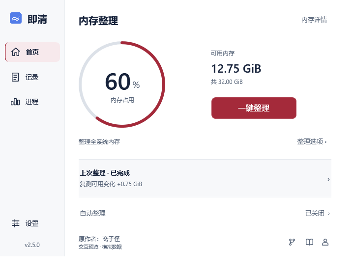
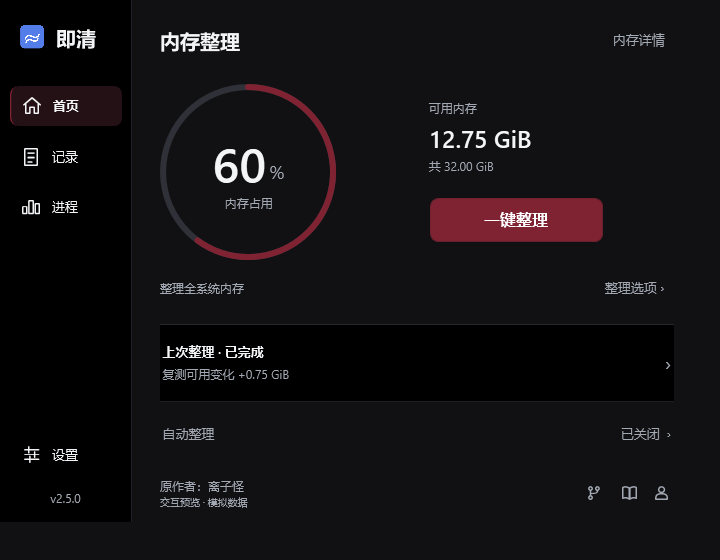
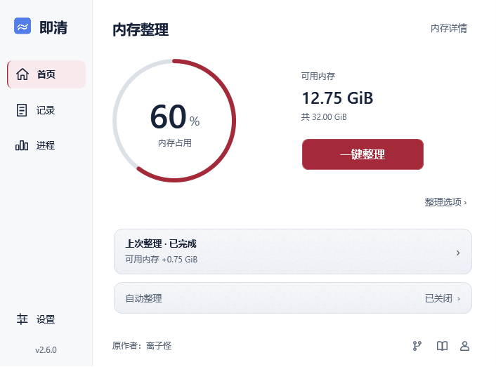
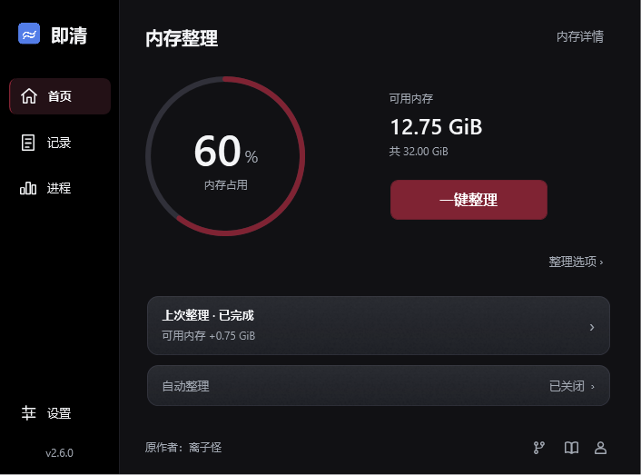
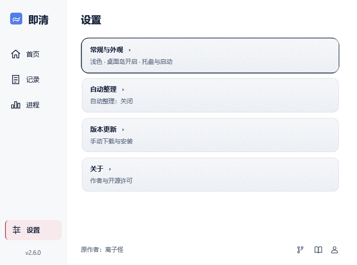

# 首页信息层级修订

日期：2026-10-13。基于 2.5.0 的界面修订，纳入 2.6.0。界面截图使用隔离配置和模拟数据，不能当作真实释放内存的证据。

## 问题判断

原首页把物理内存、三步说明、操作状态、上次结果、复测、持续观测、自动规则和项目链接按相近权重排列。主按钮只有 120 DIP 左右宽，与十多个文字入口竞争注意力。仅修改配色、缩小字体或增加卡片不能解决这一问题。

目标是先看见占用和整理按钮，再看结果；解释与完整数据按需打开。

## 官方参考与采用范围

- [火绒 6.0 官方用户手册](https://www.huorong.cn/Public/Uploads/uploadfile/files/20240703/huoronganquanruanjian6.0yonghucaozuoshouce.pdf)：主界面章节描述固定左侧导航及首页直接启动查杀。采用稳定导航和明确主操作，不复制资源、品牌或安全评分。
- [Windows 安全中心概览](https://support.microsoft.com/en-us/windows/security/windows-security/windows-security-app-overview)：首页提供状态概览与各功能区入口。采用分区，把操作记录、进程诊断和设置移出首页主内容。
- [Bitdefender 快捷操作](https://www.bitdefender.com/consumer/support/answer/13354/)：常用操作无需进入模块即可启动。即清只有一个主要任务，因此保留一个醒目的整理按钮，不引入六块快捷卡片。

以上依据官方文档所描述的布局与交互，不代表已安装、操作或逐像素审查这些产品当前所有版本。

## Before / After

| Before | After | 原因 |
| --- | --- | --- |
| 首页多段文字和分隔线，上下逐行阅读 | 左侧固定导航，右侧读数与主操作 | 区分找功能与执行任务 |
| 36 DIP 占比数字、小整理按钮 | 48 DIP 占比数字、176×48 DIP 主按钮、实际16 DIP按钮文字 | 主任务获得明确视觉优先级 |
| 已用、可用、总量、细条、详情同时并排解释 | 真实占用环、可用与总量；已用和系统指标进入详情 | 删除重复表达 |
| 原版三步标题、全系统说明、完成状态反复出现 | 空闲只保留简短作用范围；运行时原位显示实际步骤 | 减少重复而保留正在发生的事 |
| 首页完整展示时间、来源、即时、复测、30秒观测 | 一条结果摘要，点击同一个详情模型查看完整记录 | 避免首页成为日志报告 |
| 自动规则整段摘要 | 已关闭、已开启、暂缓、待确认或暂停；点击进入规则 | 状态优先，配置按需 |
| 每页底部三个长链接 | 保留作者署名，三个不同图标，悬停/无障碍名称说明用途 | 降低低频入口的视觉权重 |
| 窄窗口横排挤压 | 640 DIP 以下折叠导航文字，主体纵向排列并允许滚动 | 保留主按钮尺寸与键盘可达性 |

## 实现边界

默认窗口为 720×560 DIP；小窗口仍支持 440×540 DIP。左栏 132 DIP，紧凑模式 64 DIP。原生标题栏、三个项目外链、原图标、作者署名保留。

内存环由实际百分比绘制，没有性能评分、虚拟清理进度、独立动画时钟或数值补间。占用高不直接解释为危险。无有效读数时显示破折号与错误，不显示上次数字冒充实时值。

主按钮继续调用同一整理协调器。55% 自动门槛、默认手动三步、失败停止、取消后续、超时等待、复测及30秒观测逻辑不变。更新仍需用户下载和重启。灵动岛行为不在此次修改范围。

浅色保持红色强调、深蓝正文与中性背景；深色保留黑色、暗红和白色。选中导航用可读的正文色与加粗、左侧标识，避免暗红小字融进深色背景。沿用 emil-design-eng 的交互检查原则：保留既有鼠标按压反馈，导航、读数与键盘操作不新增装饰动画。

## 核验与局限

首个信息层级候选构建为零警告、零错误；145 项界面断言通过，绑定错误为 0。原始报告保存在工作区输出目录 `Click-Clean-security-ui-final/verification.json`。首轮曾发现首页超出视口 3.2 DIP，已调整间距后重新完整验证；深色导航文字对比度也已单独补验。该阶段不含发布操作。

实际 WPF 渲染检查覆盖浅深色、默认与紧凑窗口、空闲、运行、读数失败、部分失败、结果详情、设置、更新、记录、进程和灵动岛回归。截图使用模拟数据；最新修订按要求移除了首页预览标记，模拟性质在窗口标题与交付说明中注明。

自动化测试模拟系统调用和更新服务，不执行全系统内存整理、不改计划任务、不替换用户安装。100%～200% 图片为离屏倍率检查，不等同于真实 Windows DPI 切换或多显示器实测。

本次采用新版本 2.6.0，安装包与更新包验收见 verification-2.6.0.md，不覆盖 2.5.0 的公开资产。

## 圆角磨砂卡片修订（同日）

| Before | After | 原因 |
| --- | --- | --- |
| 灰色直角结果条，只有上下分隔线 | 12 DIP 圆角、半透明染色、细颗粒与柔和高光 | 给可点击的选项明确边界和轻磨砂质感 |
| 设置分类与记录使用另一套列表样式 | 结果、自动整理、设置分类与记录复用 AcrylicOption 模板 | 悬停、按压和键盘焦点一致 |
| 首页常驻交互预览、模拟数据及空闲范围说明 | 删除预览行和重复空闲说明，详细作用范围保留在整理提示中 | 降低与主操作无关的文字密度 |
| 截图使用整窗高度，底部出现一条空背景 | 按 WPF 客户区宽高绘制并验证输出尺寸 | 排除原生标题栏高度被误计入离屏画布 |

这是 WPF 中实现的亚克力风格磨砂材质，不是 Windows 原生 Desktop Acrylic，也不实时模糊桌面后景。当前卡片背后是纯色内容区，使用缓存的 64×64 颗粒纹理、透明染色和高光即可提供质感；不增加计时器，不模糊正文。高对比模式去掉颗粒与高光，改用系统颜色。

磨砂候选构建零警告、零错误；151 项界面断言通过、绑定错误为 0。原始证据位于输出目录 `Click-Clean-acrylic-ui/verification.json`。候选测试没有安装、真实内存整理或发布操作；2.6.0版本标识的复核与发行验收另见验收记录。

以下为实际控件渲染，读数均为模拟：

